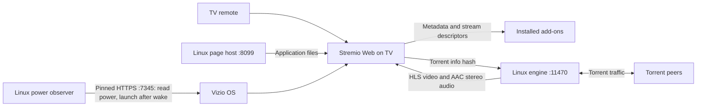

# What runs where

The full interface and video decoder run in the TV's own Chromium webview.
This is not HDMI screen mirroring. The Linux PC supplies the application files
and, for raw torrents, the streaming engine. Its watcher launches the webview
after a tested remote standby/wake transition.

Compatible direct HTTP(S) media can travel from its internet host to the TV
without the Linux engine. The current UI still requires the Linux page host.
Ordinary TCP/uTP torrents and the tested audio conversion require the Linux
engine; a generic browser WebTorrent library is not an equivalent replacement.

No TV root access, bootloader unlock, replacement OS, installed native torrent
engine, or native persistent startup has been demonstrated. Vizio OS remains
responsible for power, inputs, the initial Home destination, account requirements, and system ads.
The custom application covers that interface while active; it does not remove
the underlying account or advertising components.

All three Linux services are enabled for the user's session. They require an
awake, connected PC and the known addresses. The watcher now has an optional
Home redirect, enabled after a read-only observation distinguished SMARTCAST +
app namespace 4 / ID 1 from HDMI-2. The owner verified that physical Home shows
Vizio Home for roughly two to three seconds, then the clean local launcher. This is
external automation, not a replaced Home application. Running apps and HDMI
are excluded from the redirect match. Physical Input → HDMI-2 remains the
escape; the owner reported the app-launch / Home-return / TV-HDMI flow worked.
The next observed off→on transition is also configured for the clean page.
Stop or configure the watcher as described in `docs/recovery.md`.
